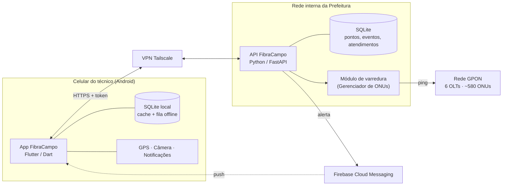
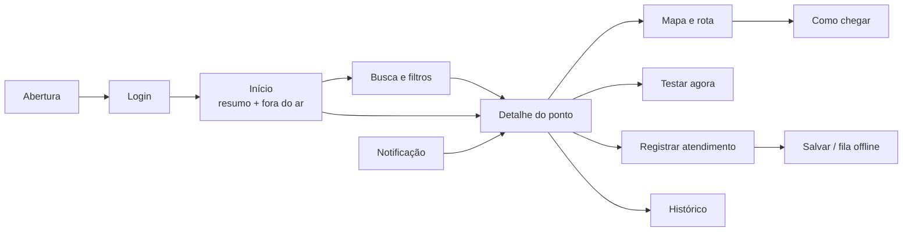
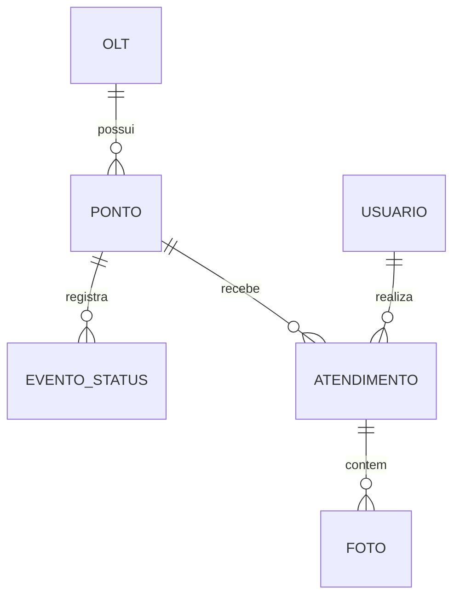

# Arquitetura inicial – FibraCampo

Documento de apoio ao Relatório Incremental (2ª entrega). Os diagramas abaixo são a versão inicial e serão refinados ao longo das sprints.

## Visão geral

## Fluxo de navegação

## Modelo de dados inicial

